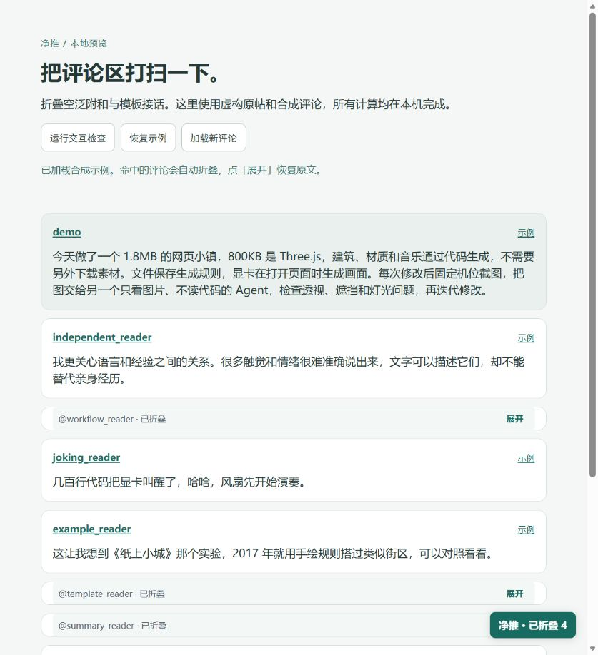

# Jingping · A quieter X reply section

**Fold replies that mostly repeat the post and finish with a generic question.**

A free, local browser extension. No tokens, API keys or server. Ordinary replies stay untouched. Filtered replies become a slim bar with one **Expand** button (currently labeled in Chinese).

[Download](https://github.com/smyll/jingping/releases) · [中文](README.md) · [Report a filtering issue](https://github.com/smyll/jingping/issues/new/choose)

## Install

1. Download **jingping-v0.1.2-edge-chrome.zip** from Releases and extract it.
2. Open `edge://extensions` or `chrome://extensions` and enable Developer mode.
3. Click **Load unpacked** and select the extracted **extension** folder.
4. Refresh X and open a post's replies. Use the extension popup to change sensitivity or pause filtering.

Tested on desktop Edge with real X pages. Chrome uses the same package but has not been independently tested. Mobile browsers and Firefox are not verified releases. The native X app is unsupported.

## What it does

The extension combines phrase overlap, a bundled Chinese embedding model and repeated reply structures observed while you browse. It favors keeping short questions, jokes, concrete new examples, measurements, troubleshooting details and replies with media or incomplete text.

Reported measurements can include elapsed time, memory and cost. Hypothetical targets and numbers quoted from the source do not receive measurement protection just because they include a unit.

This is a personal filter, **not an AI-authorship detector**. It does not score people from their names, blue checks or AI branding. Current tuning targets Chinese replies; English quality has not been evaluated separately.

No remote inference or model downloads at runtime. The unpacked extension is about 48MB. Limited browsing-derived features are stored locally; full reply texts are not saved as account history. See [PRIVACY.md](PRIVACY.md). The extension never blocks, reports, likes or posts on your behalf.

## Development and feedback

The repository includes the runnable extension and pinned model. Run `npm test`, `npm run check` and `npm run serve`. The local preview at `http://127.0.0.1:8766/demo/status/1000` uses synthetic examples and includes interaction checks.

To rebuild the runtime, use Node.js 22+, `npm ci --ignore-scripts`, then `node tools/build-model.cjs`. Run `npm run package` to produce a release folder.

Reports of missed or unwanted folds are welcome. Include the public source, expected behavior and your settings. If Jingping is useful, a Star helps others find it.

MIT license. Third-party model/runtime notices are bundled in `extension/licenses/`. See [validation notes](docs/validation.md) for the current test boundaries.
