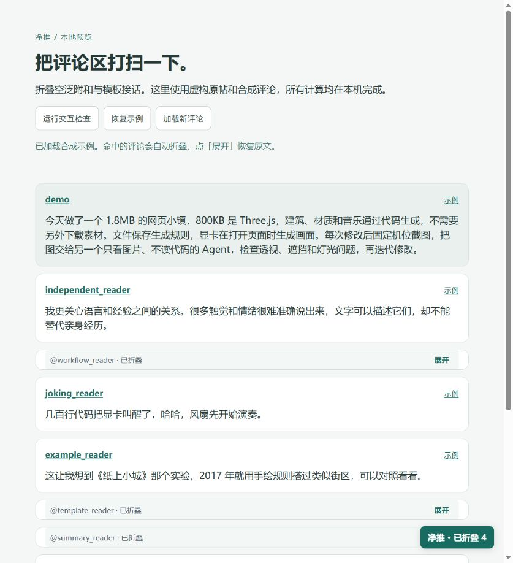

# 净评 Jingping

**把复述原帖、再接一句空泛问题的评论折起来。**

免费、本地运行的 X 评论过滤扩展。无需 Token、API Key 或服务器。正常评论保持原样，命中规则时只留一条细栏，点「展开」就能看原文。

[下载试用版](https://github.com/smyll/jingping/releases) · [English](README.en.md) · [反馈漏拦 / 误折叠](https://github.com/smyll/jingping/issues/new/choose)



*演示使用虚构账号和合成评论，运行的是扩展本身。*

## 30 秒安装

1. 在 [Releases](https://github.com/smyll/jingping/releases) 下载 **jingping-v0.1.3-edge-chrome.zip** 并解压。
2. Edge 打开 `edge://extensions`，Chrome 打开 `chrome://extensions`，开启「开发者模式」。
3. 点击「加载解压缩的扩展」，选择解压后里面的 **extension** 文件夹。
4. 刷新 X，打开一个帖子的评论区。

浏览器扩展菜单 → **净评设置**，可以调节力度、暂停，或关闭本地语义模型。升级时替换扩展文件，在扩展管理页点击刷新，再刷新 X 页面。

| 功能 | 当前情况 |
| --- | --- |
| Edge 桌面版 | 已做真实 X 页面测试 |
| Chrome 桌面版 | 使用同一安装包，尚未单独实测 |
| 手机浏览器、Firefox | 尚未发布已验证版本 |
| X 官方手机 App | 不支持，扩展只影响网页 |

## 折叠什么

- 多处复述原帖，然后附和、总结或抛出空泛问题。
- 重述原帖后追加没有实际结果的试用意向、收藏学习意向或泛化建议。单独的「收藏了」短评保留。
- 在你浏览过的不同帖子下，反复出现相似接话结构的账号；账号历史只辅助本条判断。

短问题、普通短附和、笑话、具体新例子、报错与实测数据优先保留。带图片、视频或尚未展开全文的评论也先保留。主帖、主帖作者的回复、自己的回复不折叠。

实测数据包括新增的耗时、内存、费用等结果；假设、性能目标或转述原帖数字不会仅因带单位就获得保留优先级。

**它是个人过滤器，不是 AI 作者鉴定器。** 不因蓝 V、昵称里带 AI 或发帖频繁就隐藏评论。当前重点优化中文，英文效果尚未专门评估。

## 使用时是什么样

- 默认自动折叠；点「展开」恢复原评论，本次浏览不再自动收起它。
- 正常评论与展开后的评论没有评分、理由面板或工具栏。
- 标准、温和、较强三档力度；暂停或「仅后台评分」会恢复所有评论。
- 不拉黑、不静音、不举报，也不操作你的 X 账号。

## 本地运行

规则和量化的 **BGE-small-zh-v1.5** 模型都在本机运行。安装包内置模型与运行时，约 48MB 解压大小；使用时不向外部 AI 服务发送原帖或评论，也不下载远程模型。

账号观察仅来自你打开的页面，不自动访问账号主页。只保存有限的结构特征与时间，不保存完整评论正文。详见 [本地数据说明](PRIVACY.md)。首次加载模型稍慢，较弱设备可在设置里关闭语义辅助。

## 试用版的效果

最新一轮在 **4 个新的 X 帖子下检查了 119 条回复**，发现一条「多处复述原帖＋收藏慢慢消化」漏拦。修正后已回到真实页面确认自动折叠，展开后原文正常恢复；同批文本重算中其余 118 条处理结果不变。默认仍偏保守，短评论优先保留。

此前还完成过另外 3 个帖子的 87 条抽查。这些是过滤偏好检查，不是 AI 来源准确率。

仍有换措辞复述的漏拦；X 改版、长文截断和上下文不完整也会影响效果。详细验证边界见 [验证记录](docs/validation.md)。

欢迎提交**漏拦或误折叠**：附公开原帖链接、评论片段、预期处理和当前设置即可。愿意试用的话，Star 或反馈都能帮助这个小项目继续改进。

## 开发

仓库已经包含可加载的扩展和固定版本模型。仅改规则不需要构建。

```sh
npm test
npm run check
npm run serve
```

打开 `http://127.0.0.1:8766/demo/status/1000`，点击「运行交互检查」。演示使用合成语料，不读取 X 账号。

修改模型运行时代码时需要 Node.js 22+：

```sh
npm ci --ignore-scripts
node tools/build-model.cjs
npm run package
```

模型固定版本见 `extension/models/bge-small-zh-v1.5/REVISION.txt`，原始来源为 [Xenova/bge-small-zh-v1.5](https://huggingface.co/Xenova/bge-small-zh-v1.5)，基础模型来自 BAAI。第三方许可保存在 `extension/licenses/`，项目代码采用 [MIT](LICENSE) 许可。
